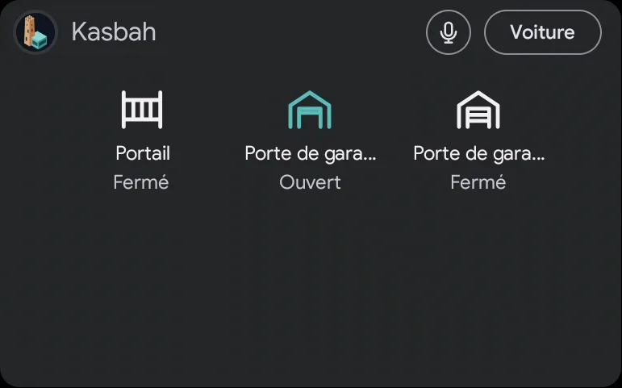
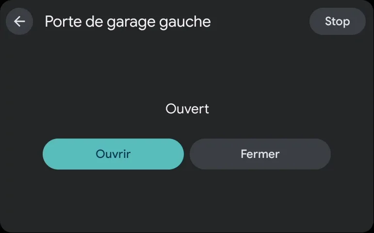
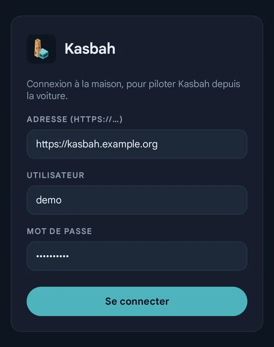
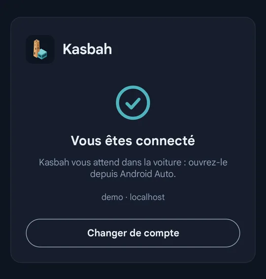

# Android Auto app

An Android app (`apps/android`) that puts Kasbah on the car's screen through **Android Auto**. It runs on
the phone; Android Auto shows it in the car. It uses the routes the web app already uses: nothing to
change on the server.

| On the car's screen | |
|---|---|
|  |  |

| On the phone | |
|---|---|
|  |  |

Screenshots of the demo property in Google's Android Auto simulator (simulated devices only); the
Android Auto parts around the app (map, app bar) are cut out.

## What it does

- **Gates and garage doors**: one tile per cover whose class is `gate` or `garage`, with its state
  (closed, open, opening…, offline, or unknown for a one-way radio motor). Tapping a tile never moves
  anything: it opens a screen with **Open**, **Close** and **Stop**.
- **Talk**: the microphone button listens to one sentence through the car's microphone, sends it to the
  transcription, then to the assistant ("Ask Kasbah"), and says the answer aloud with the Kasbah voice
  (the account's voice, when *spoken answers* is on in the transcription plugin), or with Android's own
  voice otherwise. The end of the sentence is detected as in the web app (one second of silence).
- **Car**: a probe of what Android Auto reports about the car (model, energy and connector types,
  battery and range, speed, odometer). Raw values, also written to the phone's log
  (`adb logcat -s KasbahProbe`). Android Auto does not report tire pressure.
- **Phone screen**: the server address and the sign-in, styled like the server's sign-in page. The
  password is sent once and never stored; only the session cookie is.

The app needs the server's **public address** (see [Remote access](../README.md#remote-access)) when the
phone is away from home. On the local network, it works without an account.

## Building and installing

Requirements: Android Studio (it brings the JDK and the SDK manager), with the Android 15 (API 35)
platform, the SDK platform-tools, and the *Android Auto Desktop Head Unit Emulator* (SDK Tools tab).

```bash
cd apps/android
export JAVA_HOME="<Android Studio>/jbr" ANDROID_HOME="<Android SDK>"
./gradlew assembleDebug
adb install -r app/build/outputs/apk/debug/app-debug.apk
```

An app installed this way shows in the **simulator** only. **A real car only shows car apps installed
from Google Play**: Android Auto's *Unknown sources* developer option covers media and messaging apps,
not apps built with the Car App Library like this one
([Google's testing guide](https://developer.android.com/training/cars/testing)). The simulator skips the
check, so everything can look fine on a computer and the app still be missing in the car. For the car,
go through Play's **Internal app sharing**, which needs a Google Play developer account (one-time
fee) but no review and no public listing: upload the APK there, open the link Google gives on the
phone, and the app installs from Play. Uninstall a version installed by `adb` first: Play will not
replace an app signed with another key.

On the phone, open **Kasbah Auto** (the logo with a car badge, to tell it from the installed web app),
enter the server address, the user and the password, and allow the microphone. In Android Auto the app
shows as **Kasbah**, without the badge. The app follows the phone's language: English, or French on a
phone set to French.

## Trying it on a computer

`apps/android/dhu.cmd` (Windows) starts Google's Desktop Head Unit simulator against the phone plugged in
by USB. It says what to do on the phone first (Android Auto's menu, **Start head unit server**), waits for
a key, then opens a wide car screen; `dhu sensors` opens an 800×480 screen with simulated car data
(`fuel`, `range`, `speed`, `odometer` commands in its console). The simulator uses the computer's
microphone.

**In the simulator, Open and Close move the real gate and garage doors.**

If the simulator stays on "waiting for phone" or disconnects right after connecting, close it, restart
the head unit server on the phone, and start the script again. Quit the simulator with `quit` in its
console rather than killing it.

## Why not an app inside the car

Cars with Google built-in (Renault's openR Link, for instance) only install apps from the Play Store, and
reading tire pressure there needs a permission that third-party apps only get from Android Automotive 15
on. Android Auto, projected from the phone, needs neither. Details, in French, in the wiki:
[1_15 Appli Android Auto](../doc/1_architecture/1_15_appli-android-auto.md).
