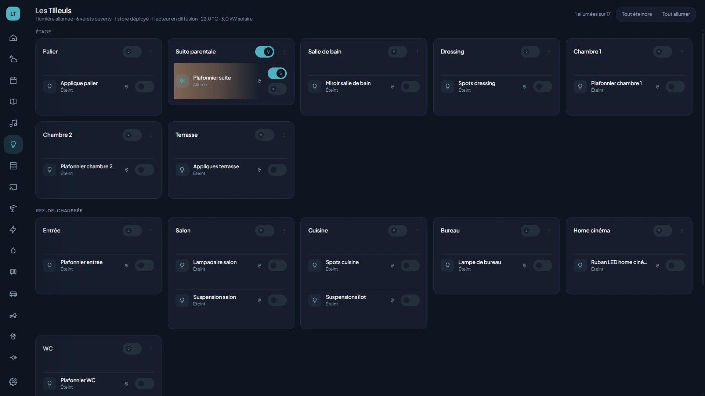

# Philips Hue

| | |
|---|---|
| **Id** | `hue` |
| **Devices** | lights (`light`), and optionally Hue rooms as group lights |
| **Connection** | **local**: the bridge's CLIP v2 API, on the house network |
| **Account** | no online account: an application key obtained by pressing the bridge button |
| **Views** | Home (3D pills, room panel), Lights, Settings → Plugins |

*Screenshot of the demo (simulation, no real device).*

## What the plugin does

- **Lights**: on, off, brightness, warm / cool white (depending on the light), color (depending on the light).
- **Light effects** offered by the bridge (candle, fire, prism, sparkle…), when the light supports them.
- **Light scenes** (Hue scenes): list by room or zone, with their color swatches; **static** or **animated** recall (scrolling palette), scene switch-off. Create a scene for a room from Kasbah, and set "start animation automatically".
- **Real time**: any change made elsewhere (Hue app, wall switch, another screen) is displayed immediately, through the bridge's event stream.
- **Automatic placement**: a light not declared in the house file is placed in the house room that has **the same name** as its Hue room. Otherwise, it stays controllable in the Lights view, flagged "Not placed".
- Option: expose each **Hue room** as a group light (`HUE_EXPOSE_ROOMS=true`).
- **Lights in rhythm with the music**: when Kasbah plays YouTube Music or Mixcloud on a speaker, the lights of that speaker's room can pulse with the bass and change color on the beats (bulb button on the player's row in the Music page, **Listening** panel). It uses the bridge's Entertainment stream, so the room needs an **entertainment area** (Hue app: Settings → Entertainment areas) with at least half of its lights in that room (a lamp of the next room in it follows the music too; an area entirely in the room is preferred). The small arrow next to the bulb opens the room's settings, applied live: the **effect** (Wave by default, Pulse, Spectrum, Strobe, Breathe), the **mood** (Calm ↔ Energetic), the maximum **brightness**, and the **colours** (ready-made palettes, the colours of a Hue scene of the room, colours picked by hand — or drawn at random by a colour-wheel rule, so they go together —, or the cover art of the playing track). Settings are kept per room. When the music plays in the browser itself (**This browser** row), there is no room to follow: its bulb first asks for one, and any room with an entertainment area can be chosen, wherever the device is.

## Connection

Everything goes over the local network: the Kasbah server talks directly to the bridge over HTTPS (the bridge's certificate is self-signed by Signify, accepted for this one client only). No call to the Philips cloud, except the bridge lookup if its address is not known.

## Setup

1. Tick **Hue** in **Settings → Plugins**.
2. Without `HUE_BRIDGE_HOST`, the bridge is looked up through `discovery.meethue.com`; its address appears in the server log. Then copy it into `.env` (and give it a DHCP reservation).
3. The plugin goes to **"Pairing required"**. In the Hue section of Settings → Plugins: press the **round button on the bridge**, then within 30 s **Pair the bridge**.
4. The key is displayed and works right away. Copy it into `apps/server/.env` (`HUE_APP_KEY=…`, and `HUE_CLIENT_KEY=…` shown with it) so that it survives a restart: the server never writes this file.

A lost key is replaced with the same gesture (**Pair the bridge again**). A pairing made before the light sync existed did not keep the client key: pair again to get it.

## Configuration (`apps/server/.env`)

| Variable | Default | Purpose |
|---|---|---|
| `HUE_BRIDGE_HOST` | — (discovery) | IP address of the bridge |
| `HUE_APP_KEY` | — | Application key obtained from pairing |
| `HUE_CLIENT_KEY` | — | Client key given with it (32 hex characters); needed for the lights in rhythm with the music |
| `HUE_EXPOSE_ROOMS` | `false` | Also exposes Hue rooms as group lights |
| `HUE_TLS_INSECURE` | `true` | Accepts the bridge's self-signed certificate |

## Limitations

- Online discovery is rate-limited by Philips (about one call per quarter of an hour): set the address.
- Throughput: the bridge accepts about ten commands per second; while a slider is being dragged, only the last value is sent.
- A light cannot receive an effect and a color at the same time: the effect takes priority.
- Lights in rhythm: one room at a time (the bridge streams one entertainment area at a time); radio is not followed yet; on a Sonos speaker the lights may lag by up to a second (it reports its position in whole seconds). When the music stops, the lights fade to black and stay held by the sync (the Hue app cannot control them meanwhile); switching the sync off puts them back as they were. The bridge refuses a new stream for 15 s to 3 min after the previous one ended, which is why the stream is not closed during a pause.

## Further reading

Internals, mapping and pitfalls: [wiki, Philips Hue](../../doc/3_plugins/3_1_philips-hue.md) (in French).
