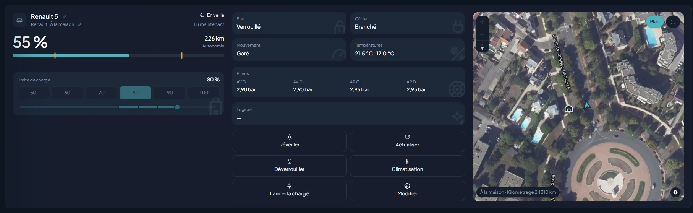

# Renault

| | |
|---|---|
| **Id** | `renault` |
| **Appareils** | véhicules (`vehicle`), un par voiture (testé sur une Renault 5 E-Tech) |
| **Connexion** | **cloud Renault, non officiel** : l'API privée de l'appli MY Renault (Gigya + Kamereon). Il n'existe aucune voie officielle pour un particulier, ni rien en local |
| **Compte** | l'adresse e-mail et le mot de passe du compte MY Renault (sans double authentification) |
| **Vues** | Véhicules, Maison (voiture en 3D, à la couleur de la caisse quand elle est connue), Réglages → Plugins |

*Capture de la démonstration (simulation, aucun appareil réel).*

## Ce que fait le plugin

- **Lecture** : charge, autonomie, câble branché et charge en cours, temps restant, limite de charge (cible) et plancher, position, kilométrage, température intérieure, couleur de la caisse.
- **Âge des valeurs** : l'heure affichée est celle de la **voiture**, pas celle de Kasbah. La R5 n'a pas de notion de veille : une donnée ancienne est le seul signe qu'elle a décroché.
- **Commandes** : **Actualiser**, régler la limite de charge, **Lancer la charge**, **Climatiser** (consigne, sièges avant et volant chauffants).
- **Arrêter la charge** passe par la borne de la maison quand elle est au bout du câble (la voiture n'a pas de commande d'arrêt) ; sans borne en charge, la commande est refusée en le disant.
- **Réveil de charge** (sous-élément coché par défaut) : la R5 ne reprend pas la charge toute seule après une coupure de la borne (charge sur surplus solaire, un nuage suffit). Branchée, hors charge, sous sa limite, dans la fenêtre horaire, Kasbah dépose une commande qui réécrit les réglages de charge de la voiture **à l'identique** (heure de départ, durée, température inchangées). Dernier réveil visible dans la section Renault de Réglages → Plugins.
- Les nombres affichés « en charge » sont recoupés : Renault annonce parfois « en attente » alors que le niveau monte, et inversement.
- **Contrat d'entretien** (au clic, pour pré-remplir une LOA) : dans « Modifier » de la carte du véhicule, « Chercher chez Renault » lit les contrats du véhicule et propose celui d'entretien plafonné en km, souvent calé sur la LOA. Renault ne publie pas le contrat de financement lui-même : rien n'est repris sans votre clic.

## Connexion

- **Cloud, usage non prévu par les conditions du constructeur** : comme toutes les API privées, elle peut changer sans préavis. Renault a ainsi changé ses clés en mai 2026, ce qui a mis en panne les intégrations tierces.
- **Mot de passe saisi dans l'interface, jamais dans `.env`** : il traverse le serveur une seule fois, n'est ni journalisé ni écrit. Seul un jeton de session est gardé dans `apps/server/.state/renault-session.json`. Il traverse en revanche votre réseau local en HTTP simple, Kasbah n'étant pas servi en HTTPS.
- **Double authentification** : un compte qui l'active ne peut pas être relié (Renault la refuse à un tiers). La liaison le dit clairement.
- **Débit** : Renault tolère environ 60 appels par heure et bloque le compte entier au-delà (l'appli MY Renault comprise, pour au moins une heure). Kasbah se limite lui-même et lit toutes les 10 minutes.

## Mise en route

1. Cocher **Renault** dans **Réglages → Plugins**. Décocher le sous-élément **Réveil de charge** si vous ne voulez pas que Kasbah écrive dans la voiture.
2. Dans la section **Renault**, saisir **l'adresse e-mail MY Renault** et le **mot de passe**, puis **Lier le compte**. Les véhicules apparaissent : « Compte lié · 1 véhicule ».
3. La voiture porte par défaut sa plaque comme nom (le surnom de l'appli n'est pas exposé par Renault) : le crayon de la vue Véhicules la renomme, dans le fichier de la maison.
4. **Délier le compte** efface le jeton de session.

## Configuration (`apps/server/.env`)

Rien d'obligatoire : tout est réglé dans les Réglages. Variables facultatives :

| Variable | Défaut | Rôle |
|---|---|---|
| `RENAULT_COUNTRY` | `FR` | Pays du compte (deux lettres) |
| `RENAULT_ACCOUNT_ID` | — | Compte Kamereon à lire si le vôtre en compte plusieurs (vide : le compte MY Renault) |
| `RENAULT_SESSION_FILE` | `apps/server/.state/renault-session.json` | Où le serveur garde le jeton de session. Vide : à relier à chaque démarrage |
| `RENAULT_POLL_MS` | `600000` | Cadence de lecture (120 000 à 3 600 000 ms) |
| `RENAULT_RATE_PER_HOUR` | `60` | Plafond d'appels par heure que Kasbah s'impose |
| `RENAULT_WAKE_FROM` / `RENAULT_WAKE_TO` | `08:00` / `20:00` | Fenêtre horaire (heure du serveur) du réveil de charge. Bornes égales : jamais. Peut chevaucher minuit |
| `RENAULT_WAKE_EVERY_MS` | `900000` | Délai minimal entre deux réveils de la même voiture (300 000 à 21 600 000 ms) |
| `RENAULT_GIGYA_URL`, `RENAULT_GIGYA_API_KEY`, `RENAULT_KAMEREON_URL`, `RENAULT_KAMEREON_API_KEY` | valeurs de la France | À ne renseigner que si Renault change ses points d'entrée ou ses clés et que le plugin tombe en panne |

## Limites

- **Une R5 endormie ne se réveille pas par l'API** : une fois son boîtier hors ligne, aucune commande ne la rappelle, pas même depuis l'appli officielle. Le réveil de charge ne rattrape donc pas toutes les situations.
- Une commande est **déposée** chez Renault et n'agit que quand la voiture se reconnecte ; Kasbah relit après un délai pour le constater. Un refus « commande déjà en attente » est un report, pas une panne : réessayer dans quelques minutes.
- **Lancer la charge** désactive les programmes de charge de la voiture (c'est eux qui la font attendre) et ne les rétablit pas : à rallumer dans l'appli MY Renault.
- Absents pour la R5 : verrouillage, pression des pneus, vitesse, température extérieure, puissance de charge instantanée (estimée à l'affichage d'après la capacité de batterie saisie dans la maison).
- La couleur n'est connue que pour les teintes déjà vérifiées sur une voiture réelle ; sinon la scène garde sa couleur de thème.
- La climatisation et le lancement de charge n'ont pas encore été essayés sur la voiture réelle.

## Pour aller plus loin

Fonctionnement interne, captures de l'API et diagnostics : [wiki, Renault](../../doc/3_plugins/3_9_renault.md).
