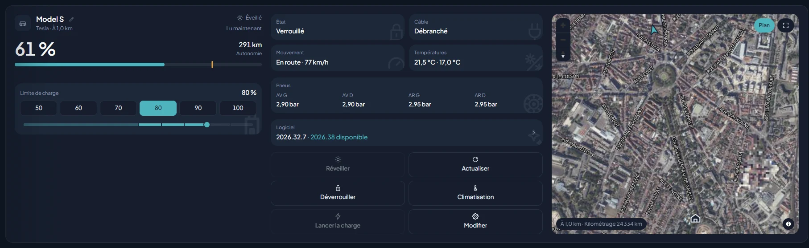

# Tesla

| | |
|---|---|
| **Id** | `tesla` |
| **Devices** | vehicles (`vehicle`), one per car |
| **Connection** | **Tesla cloud** (official Fleet API, pay-per-use but with a monthly credit): there is nothing local |
| **Account** | an application on `developer.tesla.com` (client ID and secret), a public HTTPS domain serving a public key, then the Tesla account that consents |
| **Views** | Vehicles, Home (the car in 3D, in the paint colors), Settings → Plugins |

*Screenshot of the demo (simulation, no real device).*

## What the plugin does

- **Reading**: charge level, range, cable plugged in and charging in progress, charge limit, estimated end of charge, lock state, position (on the map, with the heading), mileage, speed and gear, pressure of the four tyres (a tyre the car flags as under-inflated raises an alert, critical if much lower), temperatures, software version and pending update, paint color.
- **Sleep**: the "asleep" state is a normal state, shown as such. The last known values stay visible, dated ("Read 12 min ago").
- **Commands**: **Wake up**, **Refresh** (read now, without waking), set the charge limit, **Start charging** / **Stop charging**, **Climate** (target temperature, heated seats and steering wheel), schedule or cancel the installation of a software update (**Install now**) with its release notes in the app's language.
- **Waking**: never an automatic wake-up, except for the actions you ask for (button, automation): starting a charge and climate wake the car if it is asleep. Other settings are refused while it sleeps.
- Climate is refused when the battery is below 20% (refusal by the vendor).

## Connection

Everything goes through the Tesla cloud (`fleet-api`, region `eu` by default). Three constraints follow:

- **A public HTTPS domain**, even for a simple read: Tesla requires the application's public key to be served at `https://maison.example.org/.well-known/appspecific/com.tesla.3p.public-key.pem`. Kasbah runs on your local network: it is up to you to put that file on a domain of your own (a NAS, a small hosting plan). The server generates the key pair; the private key never leaves `TESLA_KEY_FILE`.
- **A domain belongs to only one application**: if you recreate the application (even under another developer account), the domain is "already taken". Keep the first application: any Tesla account can then give it access to its car.
- **The tokens** are kept by the server (`apps/server/.state/tesla-token.json`): nothing to copy into `.env`. The refresh token is single-use and rewritten every time it is used: do not delete this file.

## Setup

1. On `developer.tesla.com`, create an application ("Authorization Code" type), allowed origin `https://maison.example.org`, redirect equal to `TESLA_REDIRECT_URI`, all vehicle scopes ticked. No bank card is needed.
2. Set `TESLA_CLIENT_ID`, `TESLA_CLIENT_SECRET`, `TESLA_DOMAIN` (the name alone, without `https://`) and `TESLA_REGION` in `apps/server/.env`, then restart the server.
3. Tick **Tesla** in **Settings → Plugins**. The **Tesla** card offers three steps:
   1. **Copy key**: copy the public key and put it at the indicated address on your domain (text file, served over HTTPS);
   2. **Register the domain**: the server declares it to Tesla and checks that the key read back is its own;
   3. **Link the Tesla account**: the consent screen opens in a tab. On return, **Refresh**: the vehicles appear.
4. The card disappears when everything is done. **Generate a new key** exists in case the key is lost: put it back on the domain, then register the domain again.

## Cost and monthly credit

Tesla has billed for the API since 2025: a credit of **$10 per month and per account** (cycle from the 1st to the last day of the month), then full read $1 per 500, wake-up $1 per 50, command $1 per 1,000. With no card on file, Tesla simply cuts off once the credit is used up.

- **Listing the vehicles and following sleep is free.** Only the full read, the wake-up and the commands cost anything.
- **Daily budget**: at most `TESLA_DAILY_DATA_BUDGET` full reads per day (100 by default, i.e. $6 per month at worst). Once used up, only sleep is followed until the next day.
- A car seen at rest is not read again for 15 minutes (`TESLA_REST_MS`), the time it takes to fall asleep; on the road or charging, it is read again every round (10 minutes).
- The gauge in the Vehicles view is an estimate: the Tesla developer console remains the reference.

## Configuration (`apps/server/.env`)

| Variable | Default | Purpose |
|---|---|---|
| `TESLA_CLIENT_ID` | — | Client ID of the application |
| `TESLA_CLIENT_SECRET` | — | Secret of the application |
| `TESLA_DOMAIN` | — | Domain (name alone) serving the public key |
| `TESLA_REGION` | `eu` | Region of the account: `eu` or `na` |
| `TESLA_REDIRECT_URI` | `http://localhost:8787/api/plugins/tesla/auth/callback` | Must be identical to the redirect declared in the application (the port is the server's) |
| `TESLA_TOKEN_FILE` | `apps/server/.state/tesla-token.json` | Where the server keeps the tokens. Empty: the link is lost at restart |
| `TESLA_KEY_FILE` | `apps/server/.state/tesla-key.json` | Where the server keeps the key pair |
| `TESLA_STATE_FILE` | `apps/server/.state/tesla-state.json` | Last vehicle states, color and the month's usage (nothing secret). Empty: nothing is kept |
| `TESLA_POLL_MS` | `600000` | Read interval of the list (60 000 to 3 600 000 ms) |
| `TESLA_REST_MS` | `900000` | Delay with no re-read for a car at rest (`0` = no rest) |
| `TESLA_DAILY_DATA_BUDGET` | `100` | At most this many full reads per day (`0` = sleep only) |

## Limitations

- Commands tried without a signature (charge limit, charging, climate) go through on a 2017 Model S; more recent models may require a virtual key installed in the car, which Kasbah does not handle.
- Locking / unlocking is not yet available.
- The car takes 20 seconds to a minute to react to a charge command: the state updates at the next read.
- A Model S or X from before 2021 may stay awake because of the reads (battery); reduce the budget or lengthen `TESLA_POLL_MS` if needed.
- Failures of a preconditioning started from an automation only show up in the server log.

## Further reading

Internals, routes, tests on the real car and pitfalls: [wiki, Tesla](../../doc/3_plugins/3_8_tesla.md) (in French).
